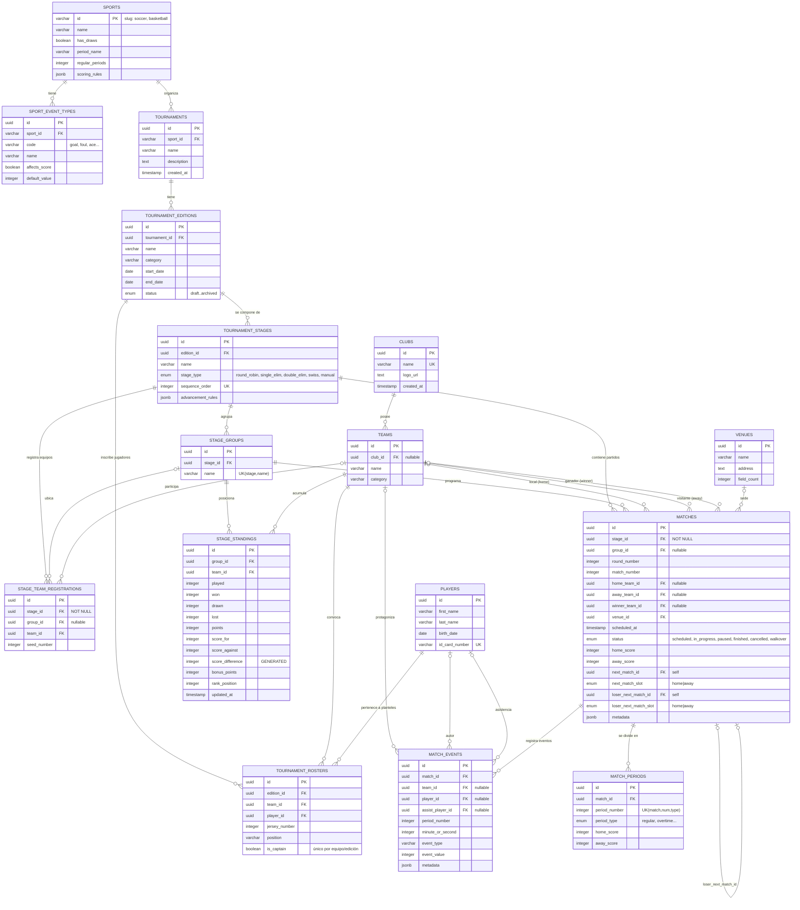

# ERD — Sports Platform Database

Diagrama Entidad-Relación del esquema de `@sports/db` (PostgreSQL + Drizzle ORM).

## Notas

- Las líneas `|o--o` indican FK nullable (opcional); `||--o` indica NOT NULL (obligatoria).
- `MATCHES` tiene dos auto-relaciones para la progresión de llaves:
  - Eliminatoria simple: `next_match_id`.
  - Eliminatoria doble: además `loser_next_match_id`, con slots `home|away` para saber en qué posición entra el ganador/perdedor.
- `STAGE_TEAM_REGISTRATIONS` es la tabla de unión etapa↔equipos; el grupo es opcional para soportar eliminatoria y sistema suizo.
- `SCORE_DIFFERENCE` es una columna generada (`score_for - score_against`) y no debe escribirse manualmente.
- Las relaciones de aplicación (para `db.query.*` de Drizzle) están declaradas en `src/relations.ts`.
